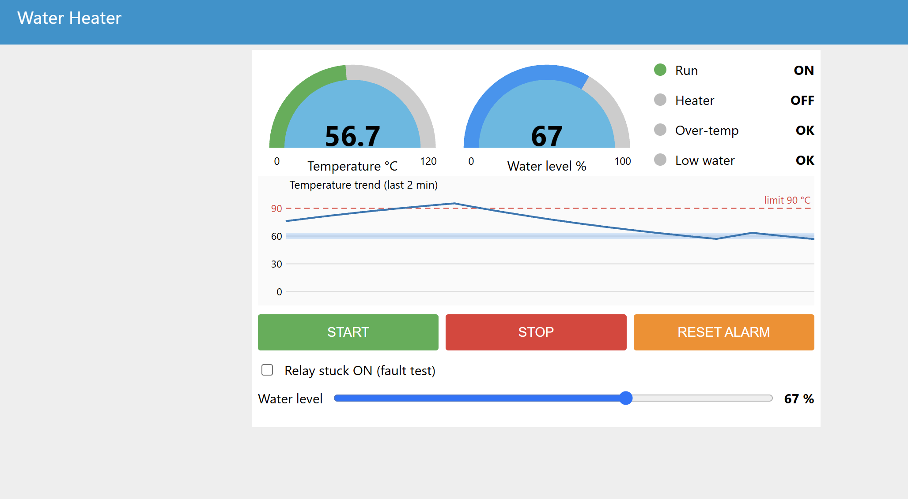

# Water Heater PLC Controller with Live HMI

A water heater controller written in IEC 61131-3 **Structured Text**, running on **OpenPLC Runtime** and visualised with a **Node-RED** dashboard over **Modbus TCP**. Everything uses free software, and it runs on one PC with no hardware.



## What it does

| Function | Behaviour |
|---|---|
| Start / Stop | Latching start with a stop that always wins |
| Thermostat | Heater ON below 57 °C, OFF above 63 °C (60 °C setpoint, ±3 °C hysteresis) |
| Over-temperature alarm | Trips above 90 °C, latches, stops the system. Reset works only after the water has cooled |
| Dry-fire protection | Heater forced OFF below 25 % water, resumes above 30 %, with a 2 s on-delay against splashing |
| HMI | Gauges, status lamps, temperature trend, Start / Stop / Reset buttons, water level slider, "relay stuck ON" fault test |

The temperature and water level in this demo come from a **simulated tank** in Node-RED. The PLC reads them through Modbus holding registers as if they were sensors. See [Going to real hardware](#going-to-real-hardware).

## How it fits together

```
 Node-RED dashboard  <--- Modbus TCP, port 502 --->  OpenPLC Runtime (runs heater_control.st)
 (tank simulation + HMI)                              reads TEMP_SIM / LEVEL_SIM, drives HEATER / alarms
```

## Repository contents

| Path | Purpose |
|---|---|
| `src/variables.txt` | Variable declarations for the OpenPLC Editor |
| `src/heater_control.st` | The control program (Structured Text) |
| `node-red/flow.json` | Dashboard and tank simulation flow |
| `docs/images/` | Screenshots |

## Requirements

- Windows 10/11 (the steps were tested on Windows 11)
- [OpenPLC Editor](https://autonomylogic.com) and OpenPLC Runtime v4
- [Node.js](https://nodejs.org) LTS (includes npm)

## Step-by-step setup

### 1. Install the tools
1. Install OpenPLC Editor and OpenPLC Runtime v4 and start the Runtime (a console window opens; leave it open).
2. Install Node.js (LTS). Check with `node --version` in a new PowerShell window.

### 2. Create the PLC project
1. In the Editor, create a new project with a **Structured Text** program named `main`.
2. Open the variable panel in code view (the `</>` button) and replace its content with `src/variables.txt`.
3. Paste `src/heater_control.st` into the program body.

> **Naming tip:** do not name a variable `LIMIT`. It is a standard IEC function and the build fails with "unresolved overloaded function type". This project uses `TEMP_LIMIT`.

### 3. Add the Modbus server
1. In the project tree, select **Servers** and add a **Modbus** (TCP) server.
2. Enable it, set port **502**, and in **Buffer Mapping** give the output areas a size above zero (for example 64 coils and 16 holding registers).

Menu and button names differ between Editor versions, so look for the nearest match.

### 4. Connect to the Runtime and upload
1. Open **Device → Configuration**, set the Runtime address to `127.0.0.1`, and connect.
2. On the first connection, create a user (username and a password of at least 8 characters). There are no default credentials.
3. Choose **Build and upload**. The Runtime console should show `PLC State: RUNNING`.

### 5. Install Node-RED and the dashboard
```
npm install -g --unsafe-perm node-red
node-red
```
Open `http://localhost:1880`, then **Menu → Manage palette → Install** and add:
- `node-red-contrib-modbus`
- `node-red-dashboard` (the classic one, not the FlowFuse dashboard)

### 6. Import the flow
1. **Menu → Import → Clipboard**, paste the contents of `node-red/flow.json`, import, and click **Deploy**.
2. Open `http://localhost:1880/ui`.

### 7. Test it
| Action | Expected |
|---|---|
| Click **Start** | Run and Heater show ON, temperature rises |
| Wait | Heater OFF near 63 °C, back ON near 57 °C |
| Drag the water level below 25 % | After about 2 s: Low water ALARM, heater OFF |
| Move it back above 30 % | Heater resumes |
| Tick "Relay stuck ON" | Over-temp ALARM at 90 °C, Run OFF |
| Untick, let it cool, click **Reset alarm**, then **Start** | Normal operation |

## Modbus map

| Address | Variable | Direction (from the dashboard) |
|---|---|---|
| Coil 0 | `HEATER` (`%QX0.0`) | read |
| Coil 1 | `ALARM` (`%QX0.1`) | read |
| Coil 2 | `LEVEL_ALARM` (`%QX0.2`) | read |
| Coil 3 | `HMI_START` (`%QX0.3`) | write (pulse) |
| Coil 4 | `HMI_STOP` (`%QX0.4`) | write (pulse) |
| Coil 5 | `HMI_RESET` (`%QX0.5`) | write (pulse) |
| Coil 6 | `HMI_RUN` (`%QX0.6`) | read |
| Holding register 0 | `TEMP_SIM` (`%QW0`) | write, 0–1023 = 0–150 °C |
| Holding register 1 | `LEVEL_SIM` (`%QW1`) | write, 0–1023 = 0–100 % |

## Troubleshooting

| Problem | Fix |
|---|---|
| Build stops with "Nothing produces %QX ... have no producer" | Add the Modbus server under **Servers** with non-zero Buffer Mapping sizes. Variables with `%IX`/`%IW`/`%MX` addresses also need a producer, so this project keeps them as plain variables |
| Build fails with `collect2.exe ... Permission denied` on Windows 11 | Smart App Control can block the Runtime's unsigned compiler helper. Turn it off, or run the Runtime in Docker |
| `GET /api/status 200` repeating in the Runtime console | Normal. The Editor polls the Runtime every 2 seconds |
| Dashboard lamps stay blank or OFF | Check the Runtime shows `RUNNING` and that the status under the Modbus nodes in Node-RED is green |

## Going to real hardware

1. Replace `TEMP_SIM` and `LEVEL_SIM` in the program with analog inputs (`%IW`) and set up a producer for them under **Device** or **Remote Devices**.
2. Wire the physical buttons, relay and lamps to `%IX` / `%QX` addresses.
3. Wire Stop and alarm contacts normally closed so a broken wire is fail-safe, and add an independent hardware over-temperature cut-out.

## Safety

This is a learning project and a simulation. **Do not use it as the only protection for a real heater.** A real installation needs an independent hardware thermal cut-out, a fused supply, and a safety review.

## License

MIT, see [LICENSE](LICENSE).
